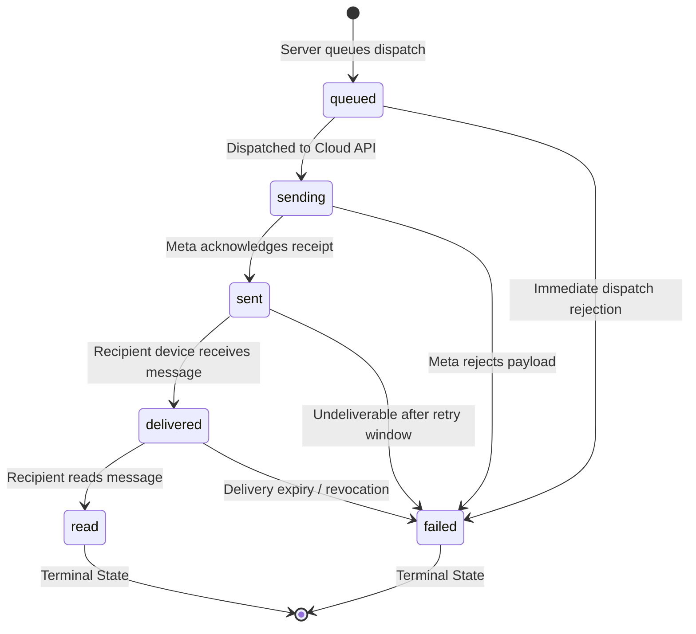

# Supabase Database, Security & Private Storage Architecture

Comprehensive operational and architectural guide for the PostgreSQL database, Row Level Security (RLS) policies, private storage buckets, and typed repositories of the Dietitian Management System.

---

## 1. Prerequisites and Tooling

| Tool                         | Version Requirement                     | Purpose                                             | Execution Requirement |
| :--------------------------- | :-------------------------------------- | :-------------------------------------------------- | :-------------------- |
| **Node.js**                  | `>=20.0.0 <21.0.0` (Pinned: `v20.20.2`) | Next.js server runtime & repository execution       | Direct host execution |
| **pnpm**                     | `12.14.0`                               | Package manager                                     | Direct host execution |
| **Supabase CLI**             | `^2.121.0` (via `npx supabase`)         | Migration management, remote link, and dry-run push | Direct host execution |
| **Docker Engine (Optional)** | Docker Desktop 4.x+                     | Only required if running offline local stack        | Optional host daemon  |

> [!NOTE]
> The primary workflow connects directly to your **Hosted Supabase Project** in cloud. Docker is not required for standard application development, migration pushes, or Vercel production deployments.

---

## 2. Hosted Supabase Deployment (Primary Workflow)

### Step 1: Project Credentials & Environment Mapping

In your Supabase Project Dashboard:

- Navigate to **Project Settings** -> **API**.
- Retrieve **Project URL** (`https://<project-ref>.supabase.co`).
- Retrieve **anon / public** key (or publishable key) and **service_role** key.
- Populate in `.env.local` (local development) and in Vercel Project Settings (production).

### Step 2: Authenticate & Link Local CLI to Hosted Project

```bash
# 1. Log in to your Supabase account
npx supabase login

# 2. Link your local codebase to your remote project reference
npx supabase link --project-ref <your-project-ref>

# 3. Verify that the project is correctly linked
npx supabase projects list
```

### Step 3: Inspect & Safely Push Migrations

```bash
# 1. Inspect unapplied migrations between local and remote
npx supabase migration list

# 2. Run a dry-run first to preview changes without modifying database state
npx supabase db push --dry-run

# 3. Apply timestamped migrations in order
npx supabase db push
```

> [!CAUTION]
> **NEVER run `supabase db reset` against your hosted database.**
> `db reset` is an offline local-only command that drops the database and applies synthetic test records from `seed.sql`. Always use `npx supabase db push` for hosted databases.

---

## 3. Local Development Stack (Optional - Docker Required)

If you wish to run a 100% offline local PostgreSQL instance:

```bash
# Start local containers (requires Docker Desktop running)
npx supabase start

# Reset local database and load synthetic test seed
npx supabase db reset
```

## 4. Environment Variables Mapping

| Environment Variable            | Scope                    | Origin in Supabase Dashboard                                                           | Security Classification            |
| :------------------------------ | :----------------------- | :------------------------------------------------------------------------------------- | :--------------------------------- |
| `NEXT_PUBLIC_SUPABASE_URL`      | Public (Client & Server) | **Project Settings** → **API** → **Project URL** (`https://<project-ref>.supabase.co`) | Public URL                         |
| `NEXT_PUBLIC_SUPABASE_ANON_KEY` | Public (Client & Server) | **Project Settings** → **API** → **Project API Keys** → `anon` `public`                | Public Key (Subject to RLS)        |
| `SUPABASE_SERVICE_ROLE_KEY`     | Server-Only              | **Project Settings** → **API** → **Project API Keys** → `service_role` `secret`        | **CRITICAL SECRET** (Bypasses RLS) |

### Security Rules for Credentials:

1. `SUPABASE_SERVICE_ROLE_KEY` must **never** be prefixed with `NEXT_PUBLIC_`.
2. `SUPABASE_SERVICE_ROLE_KEY` must **never** be imported in any file marked `"use client"` or exported to client bundles.
3. Admin client instantiations must reside in modules beginning with `import 'server-only'`.

---

## 5. Supabase Dashboard Settings Checklist

Before promoting to staging or production, verify the following dashboard configuration:

1. **Authentication Configuration**:
   - Navigate to **Authentication** → **Configuration** → **Sign Up**.
   - **Disable "Allow new users to sign up"**: Clinical staff are invite-only; arbitrary public sign-ups are prohibited.
   - Navigate to **Authentication** → **Email**.
   - Enable **"Confirm email"** to verify staff email addresses before access.
2. **Storage Bucket Privacy**:
   - Navigate to **Storage** → **Buckets** → `diet-plans`.
   - Confirm **"Public bucket"** toggle is **OFF**.
   - Confirm file size limit is set to `15MB` (15,728,640 bytes).
   - Confirm Allowed MIME Types includes only `application/pdf`.
3. **Row Level Security**:
   - Navigate to **Database** → **Tables**.
   - Confirm all five application tables (`profiles`, `clients`, `diet_plans`, `whatsapp_messages`, `audit_logs`) show **RLS: Enabled** and **Forced**.

---

## 6. Bootstrapping the Initial Administrator

All new user profiles automatically default to the least-privileged role (`staff`) via the `on_auth_user_created` trigger. Self-role escalation is blocked by the database trigger `guard_profile_role_escalation`.

To bootstrap the first `admin` user:

1. Register the administrator account via Supabase Auth (or invite via dashboard).
2. Open the Supabase **SQL Editor** in the dashboard and execute:
   ```sql
   UPDATE public.profiles
   SET role = 'admin'
   WHERE id = (
     SELECT id FROM auth.users WHERE email = 'your-admin-email@clinic.com'
   );
   ```
3. Once the first administrator is elevated, they can manage, promote, or deactivate other staff members directly through administrative tools.

---

## 7. Security Architecture, State Machine & Design Decisions

### Permission Matrix (RBAC & RLS)

| Entity / Table            | `anon` (Unauthenticated) | Active `staff`                   | Active `dietitian`               | Active `admin`                          | Service Role (Server Backend)         |
| :------------------------ | :----------------------- | :------------------------------- | :------------------------------- | :-------------------------------------- | :------------------------------------ |
| **`profiles`**            | Deny All                 | Read all; Update own `full_name` | Read all; Update own `full_name` | Full CRUD; Manage roles & active status | Full Bypass                           |
| **`clients`**             | Deny All                 | Read & Insert & Update           | Read & Insert & Update           | Full CRUD (including DELETE)            | Full Bypass                           |
| **`diet_plans`**          | Deny All                 | Read & Insert & Update           | Read & Insert & Update           | Full CRUD (including DELETE)            | Full Bypass                           |
| **`whatsapp_messages`**   | Deny All                 | Read only                        | Read only                        | Read only                               | Server-only INSERT, UPDATE (webhooks) |
| **`audit_logs`**          | Deny All                 | Deny All                         | Deny All                         | Read only (Audit review)                | Server-only INSERT (Append-only)      |
| **Storage: `diet-plans`** | Deny All                 | Read & Upload                    | Read & Upload                    | Read, Upload, Delete                    | Full Bypass                           |

---

### WhatsApp Delivery State Machine

Outbound WhatsApp notifications follow a forward-only lifecycle governed by the PostgreSQL trigger `guard_whatsapp_status_transition`:



#### State Transition Rules:

1. **No Backward Moves**: Transitions moving backward (e.g. `delivered` → `sent` or `read` → `delivered`) throw an exception.
2. **Terminal Invariance**: Once a message reaches `read` or `failed`, no further status changes are permitted.
3. **Timestamp Integrity**: `sent_at`, `delivered_at`, `read_at`, and `failed_at` are stamped automatically on status change and cannot be altered or set to `NULL`.

---

### Key Architectural Decisions

#### 1. Phone Uniqueness Decision

- **Choice**: Non-unique B-tree index on `clients(phone_e164)` + dedicated RPC duplicate detection helper `find_potential_duplicate_clients`.
- **Rationale**: In clinical dietetics, shared telephone numbers are common (e.g. parent and minor, elderly patient and adult child caregiver, spouses sharing a landline). A strict unique constraint on phone numbers would prevent legitimate care delivery. The system alerts staff to duplicate records without corrupting registration flows.

#### 2. Message Retry Design

- **Choice**: Failed messages produce a **NEW record** linked to the previous attempt via `retry_of` with an incremented `attempt_count` and a fresh `idempotency_key`.
- **Rationale**:
  1. Preserves an unalterable chronological audit trail of all previous delivery attempts and provider error responses.
  2. Guarantees idempotency compliance with Meta Cloud API (preventing replay collisions).
  3. Upholds terminal status immutability on failed records.

#### 3. Client Consent Enforcement

- **Choice**: Database constraint trigger `guard_whatsapp_consent_before_insert` blocks message insertion if `whatsapp_consent` is not `true`.
- **Rationale**: Strict legal and carrier compliance (TCPA / Meta Business Policy). Outbound communications are physically prevented at the database tier regardless of application layer bugs.

#### 4. Audit Log Visibility & Sanitization

- **Choice**: `audit_logs` is restricted to `admin` read-only. Database trigger `guard_audit_logs_non_sensitive_metadata` rejects records containing sensitive health or credential keys (`name`, `phone`, `email`, `intake`, `token`, `signed_url`).
- **Rationale**: HIPAA compliance: Audit trails must themselves be free of PHI to prevent secondary leakage during security compliance reviews.

---

## 8. Migration Rollback Strategy

Each migration file is strictly modular and re-runnable safe. If an individual migration needs to be rolled back manually, execute the corresponding SQL:

```sql
-- Rollback 8: Storage Buckets
DELETE FROM storage.buckets WHERE id = 'diet-plans';
DROP POLICY IF EXISTS "Active staff can read diet-plans storage" ON storage.objects;
DROP POLICY IF EXISTS "Active staff can upload diet-plans storage" ON storage.objects;
DROP POLICY IF EXISTS "Active staff can update diet-plans storage" ON storage.objects;
DROP POLICY IF EXISTS "Admins can delete diet-plans storage" ON storage.objects;

-- Rollback 7: Row Level Security
DROP POLICY IF EXISTS "Active staff can view staff profiles" ON public.profiles;
DROP POLICY IF EXISTS "Staff can update own profile" ON public.profiles;
DROP POLICY IF EXISTS "Admins can update any profile" ON public.profiles;
DROP POLICY IF EXISTS "Only admins can delete profiles" ON public.profiles;
DROP POLICY IF EXISTS "Active staff can view clients" ON public.clients;
DROP POLICY IF EXISTS "Active staff can insert clients" ON public.clients;
DROP POLICY IF EXISTS "Active staff can update clients" ON public.clients;
DROP POLICY IF EXISTS "Only admins can delete clients" ON public.clients;
DROP POLICY IF EXISTS "Active staff can view diet plans" ON public.diet_plans;
DROP POLICY IF EXISTS "Active staff can insert diet plans" ON public.diet_plans;
DROP POLICY IF EXISTS "Active staff can update diet plans" ON public.diet_plans;
DROP POLICY IF EXISTS "Only admins can delete diet plans" ON public.diet_plans;
DROP POLICY IF EXISTS "Active staff can view whatsapp messages" ON public.whatsapp_messages;
DROP POLICY IF EXISTS "Admins can view audit logs" ON public.audit_logs;
DROP FUNCTION IF EXISTS public.is_admin();
DROP FUNCTION IF EXISTS public.has_role(text);
DROP FUNCTION IF EXISTS public.is_active_staff();

-- Rollback 6: Indexes
DROP INDEX IF EXISTS public.idx_clients_full_name_trgm;
DROP INDEX IF EXISTS public.idx_clients_lower_full_name;
DROP INDEX IF EXISTS public.idx_clients_phone_e164;
DROP INDEX IF EXISTS public.uq_clients_source_external_ref;
DROP INDEX IF EXISTS public.idx_diet_plans_client_created_at;
DROP INDEX IF EXISTS public.idx_whatsapp_messages_client_created_at;
DROP INDEX IF EXISTS public.idx_whatsapp_messages_status;
DROP INDEX IF EXISTS public.idx_audit_logs_target_created_at;

-- Rollback 5: Audit Logs
DROP TABLE IF EXISTS public.audit_logs;
DROP FUNCTION IF EXISTS public.guard_audit_logs_append_only();
DROP FUNCTION IF EXISTS public.guard_audit_logs_non_sensitive_metadata();

-- Rollback 4: WhatsApp Messages
DROP TABLE IF EXISTS public.whatsapp_messages;
DROP FUNCTION IF EXISTS public.guard_whatsapp_consent_before_insert();
DROP FUNCTION IF EXISTS public.guard_whatsapp_status_transition();

-- Rollback 3: Diet Plans
DROP TABLE IF EXISTS public.diet_plans;
DROP FUNCTION IF EXISTS public.get_next_diet_plan_version(uuid);

-- Rollback 2: Clients
DROP TABLE IF EXISTS public.clients;
DROP FUNCTION IF EXISTS public.find_potential_duplicate_clients(text, text, uuid);
DROP FUNCTION IF EXISTS public.guard_client_code_immutability();
DROP FUNCTION IF EXISTS public.generate_client_code();
DROP SEQUENCE IF EXISTS public.client_code_seq;

-- Rollback 1: Profiles
DROP TABLE IF EXISTS public.profiles;
DROP FUNCTION IF EXISTS public.guard_profile_role_escalation();
DROP FUNCTION IF EXISTS public.handle_new_auth_user();

-- Rollback 0: Core Enums & Helpers
DROP FUNCTION IF EXISTS public.set_updated_at();
DROP TYPE IF EXISTS public.audit_action;
DROP TYPE IF EXISTS public.message_status;
DROP TYPE IF EXISTS public.staff_role;
```
